# Testing Naqsha: a guide for judges

> **Live app:** https://naqsha-242926648187.us-central1.run.app
>
> **No account needed.** Everything below works as a guest, in your own browser.
>
> | Path | What you do | Time |
> |---|---|---|
> | [A. Two-minute tour](#path-a-the-two-minute-tour) | Open a finished home, walk it, comment, see the plan | 2 minutes |
> | [B. Design your own home](#path-b-design-your-own-home) | One message to concepts, a checked plan and a 3D house | about 10 minutes |
> | [C. Collaborate like a client](#path-c-collaborate-like-a-client) | Share a link, comment as the client, revise from the comments | 5 minutes of clicks, then one revision run |
>
> Use desktop Chrome for the best result. Every screenshot below comes from the live app on 17 October 2026.

---

## Path A: the two-minute tour

No account and no waiting. You get your own copy of a finished 10 marla home, so you can click anything.

### 1. Open a sample home

Open the live link and click **Explore a sample home**.

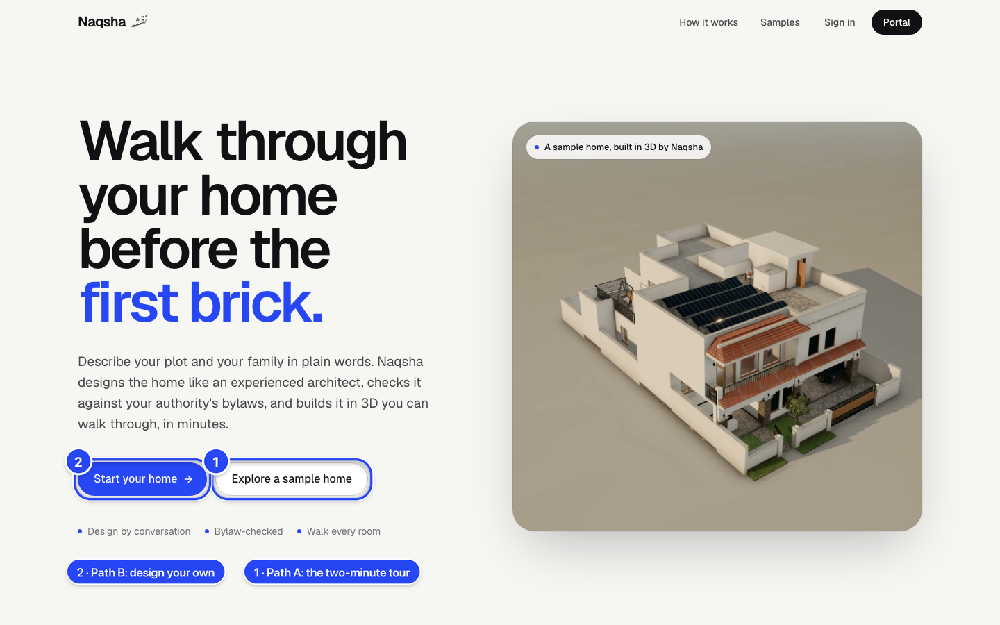

Your copy opens in **House** in about 3 seconds. If the landing page looks different from this picture, scroll to **Sample homes** and click a card, or go to **Portal** → **Samples**.

### 2. Look around in Orbit

Drag to rotate and scroll to zoom. The neighbours fade as the camera passes them.

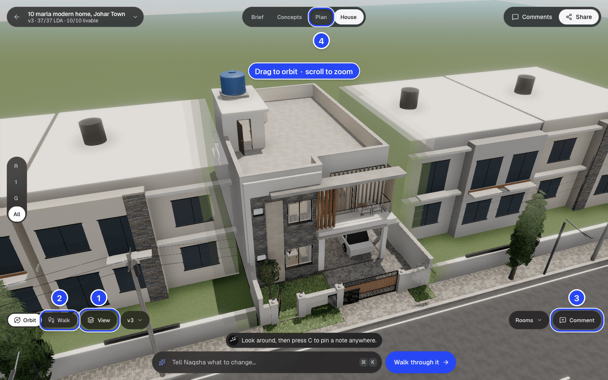

The numbers match the next steps: **1** View, **2** Walk, **3** Comment, **4** Plan.

### 3. Open the View menu

Click **View** (1).

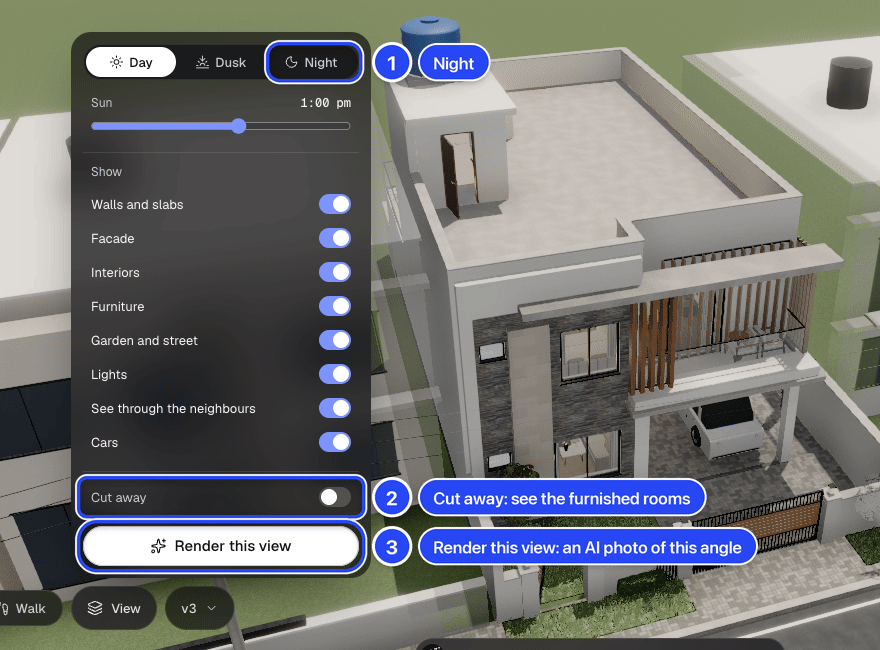

- **Night** turns on the interior, garden and street lights.
- **Cut away** slices the house so you can see the furnished rooms. The **Cut at** slider moves the cut up or down.
- **Render this view** turns the exact angle on screen into a photoreal image in about 10 seconds.

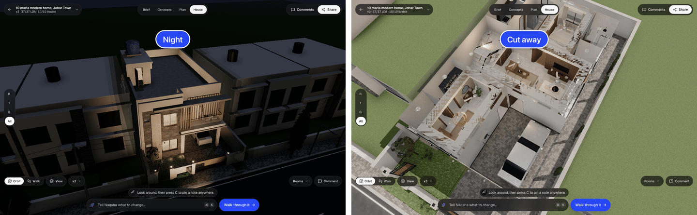

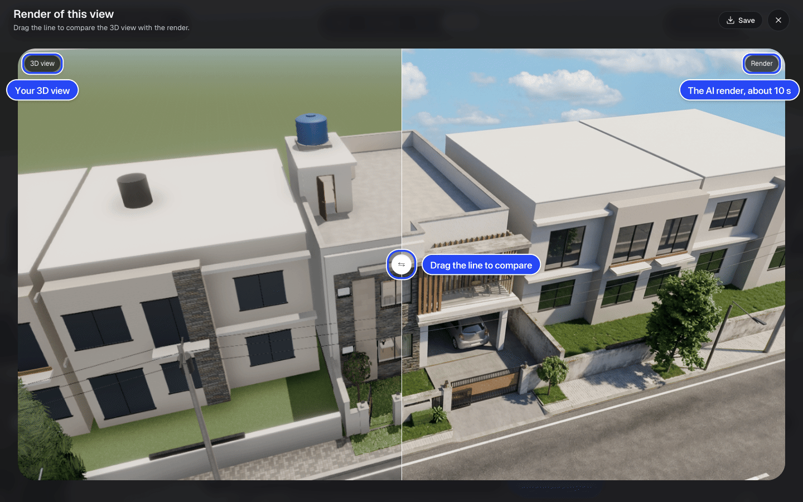

In the render, drag the line to compare the two. **Save** downloads the image. Close it with ✕ or Esc.

### 4. Walk through it

Click **Walk** (2) or press **V**. The camera flies down to the front door.

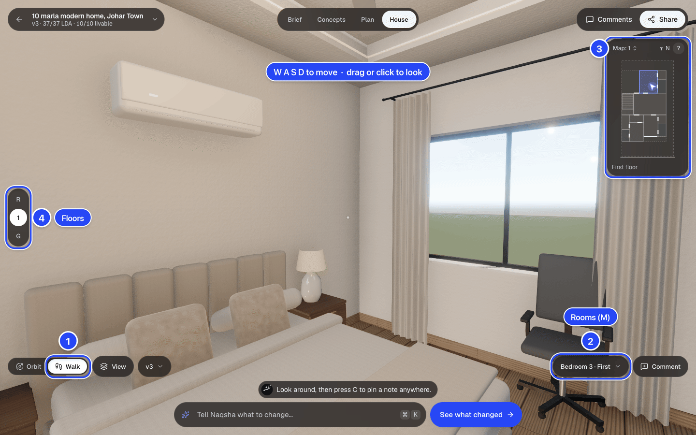

- Click once in the view, then move the mouse to look. You can also drag to look.
- **W A S D** (or the arrow keys) to move, **Shift** to run, **?** for every control.
- The minimap (3) shows where you are. Click a room on it to go there. The floor buttons (4) switch floors.
- Press **M** for the room navigator. Type a room and press Enter, and Naqsha glides you there.

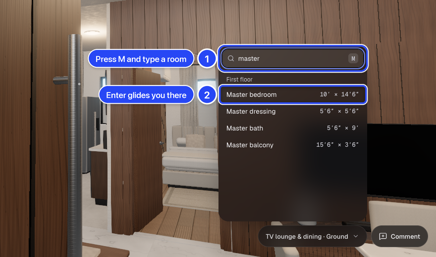

Now press **M**, type **roof** and press Enter. You climb the stairs, with their handrail and glass guard, and step out of the roof door.

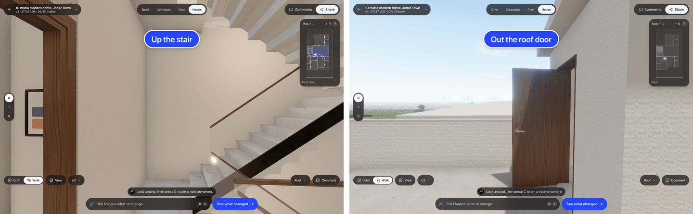

### 5. Pin a comment

- **In Walk**, look at a wall and press **C**. The note pins where the centre dot is.
- **In Orbit**, press **C** (or click **Comment**, 3), then click anything on the house. Esc stops.

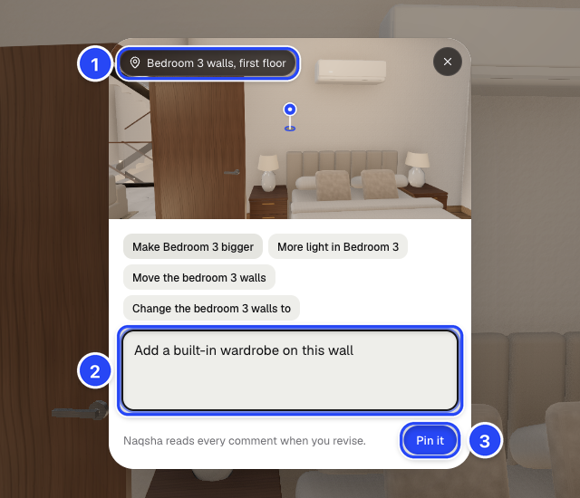

The card names the exact spot (**1**), offers suggestions, and takes your words (**2**). Click **Pin it** (**3**). The pill at the bottom now reads **Revise with 1 comment**. That is Path C.

### 6. Open the Plan

Click the **Plan** tab (4 in step 2).

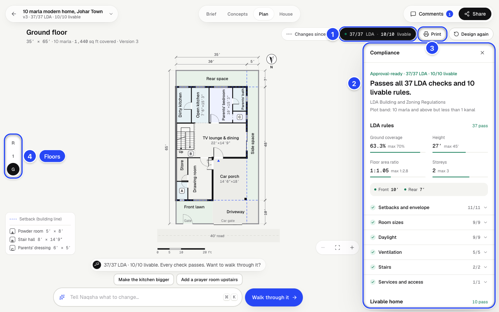

1. Click the **37/37 LDA · 10/10 livable** chip to open **Compliance**.
2. The panel shows coverage, height, floor area ratio, storeys and setbacks, then every rule group (**Setbacks and envelope 11/11**, **Room sizes**, **Daylight**, **Ventilation**, **Stairs**) and the **Livable home** rules. Click a group to expand it.
3. **Print** opens the print sheet.
4. **G**, **1** and **R** switch floors. Every floor is dimensioned.

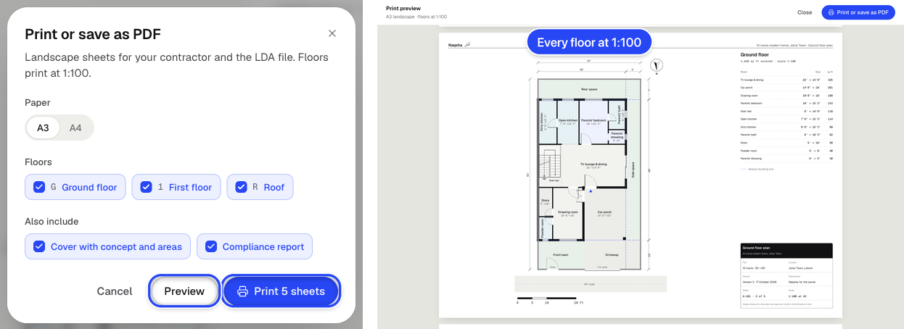

Pick A3 or A4, then **Preview** to see the sheets, or **Print 5 sheets** to print or save a PDF. Floors print at 1:100 with a title block and a room schedule.

---

## Path B: design your own home

About 10 minutes, no account. Most of that is the design run, which keeps going if you close the tab.

### 1. Open the Portal

Click **Portal** (top right of the landing page) or **Start your home**. You land on **Start a home**, or on **Your homes** if you already did Path A.

### 2. Paste the brief

Copy this into the box and press Enter:

```text
10 marla plot in Johar Town, Lahore, facing north, mid-row. Two storeys, 4 bedrooms with attached baths, drawing room, TV lounge, open kitchen plus a dirty kitchen, car porch for 2 cars. Blue plastic water tank, roof ready for solar. Modern contemporary style.
```

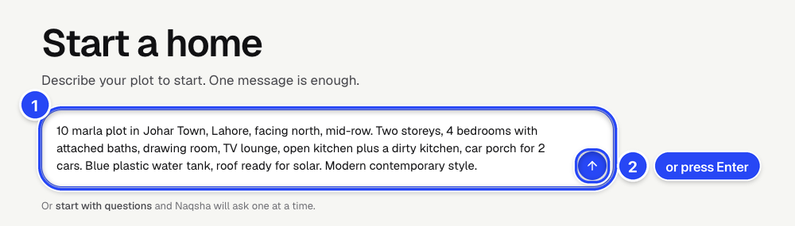

### 3. Read what Naqsha understood

The Google ADK setup agent answers within a few seconds. It fills in **Your brief**, draws the plot with the blue LDA buildable line, and asks one question: what goes on each floor. Click **Use these floors**, or **Decide for me**.

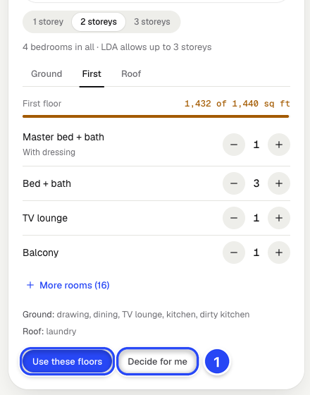

Naqsha then says **Here's what I understood**. The card lists **You said** (each fact can be tapped and corrected), **Guaranteed** (the LDA setbacks, coverage and storeys, plus the livable-home rules it promises to keep) and **Preferences**.

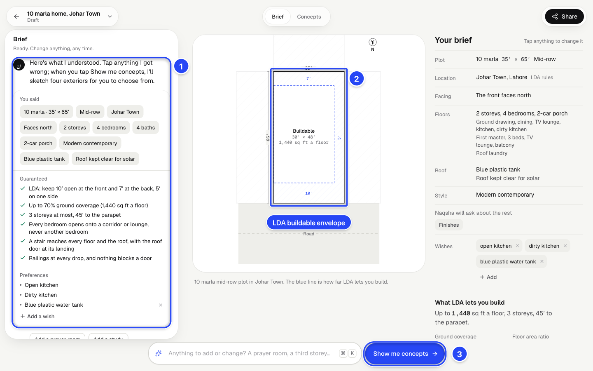

Click **Show me concepts** (3).

### 4. Pick a concept

Four exteriors appear in about 25 seconds, all from the same camera and light. Click **Night** to see the same four at night, about 15 seconds later.

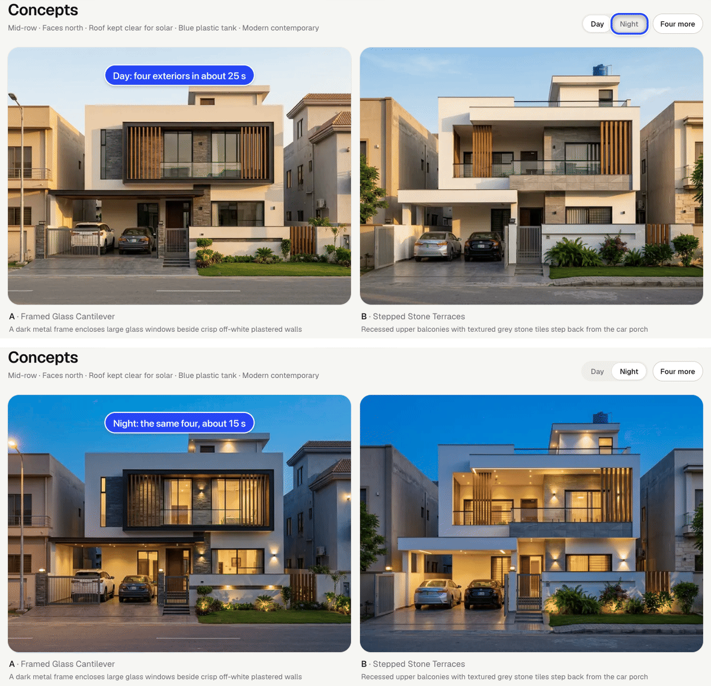

Click a concept to open it. You can remix it with a chip (**Darker glass**, **More timber**…) or by typing. When you like one, click **Plan this one**.

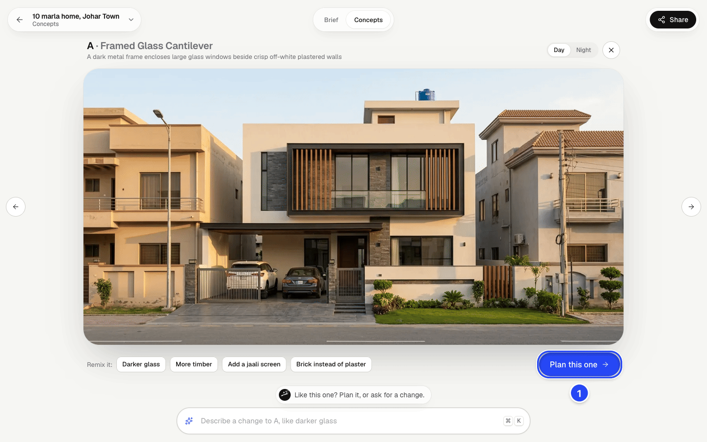

### 5. Watch the design run

The run card shows four stages, **Plan · Check · Review · Build**, with one line of narration and a clock.

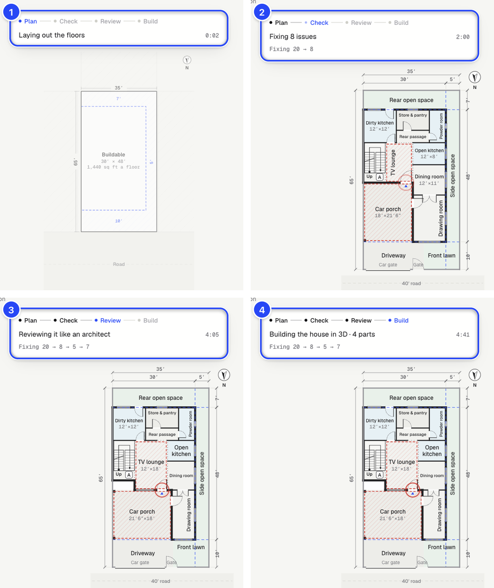

1. **Plan**: "Laying out the floors". Gemini 4 Argon writes a structured floor plan.
2. **Check**: the rules engine checks it, failing rooms turn red, and Argon fixes them. The second line counts down, for example **Fixing 20 → 8 → 5 → 7**.
3. **Review**: "Reviewing it like an architect". Argon looks at a drawing of its own plan.
4. **Build**: "Building the house in 3D · 4 parts". Argon writes the house as code, part by part.

Our 10 marla run took **6 minutes 17 seconds** (earlier runs took about 5 minutes; a 1 kanal brief takes about 8). **You can close the tab.** The run carries on, and the home is waiting in **Portal** → **Your homes** when you come back.

When it finishes, the plan and the chip at the top show the result, for example **39/39 LDA · 8/14 livable · 5 to fix · 1 to check**. A first design can leave a few livable points open. Click the chip: each open point says what is wrong and has **Ask Naqsha to fix this**. The suggestion **Fix the rules that still fail** asks for all of them at once.

### 6. Explore and walk your house

Click **House** (or **Walk through it**). Your house assembles in about 15 seconds. Everything from Path A works here: orbit, View, Walk, the room navigator, comments.

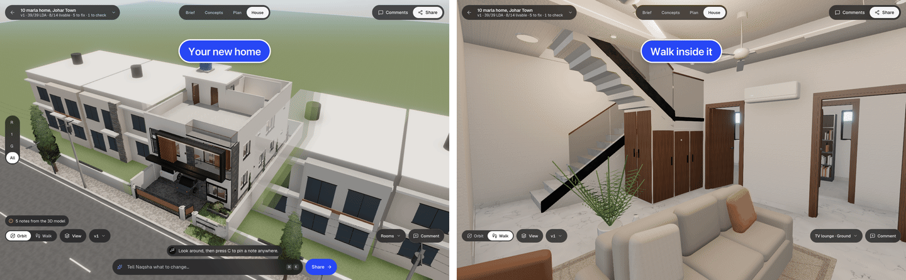

### 7. Ask for a change

Click the bar that says **Tell Naqsha what to change…**, type **Make the kitchen bigger** and press Enter.

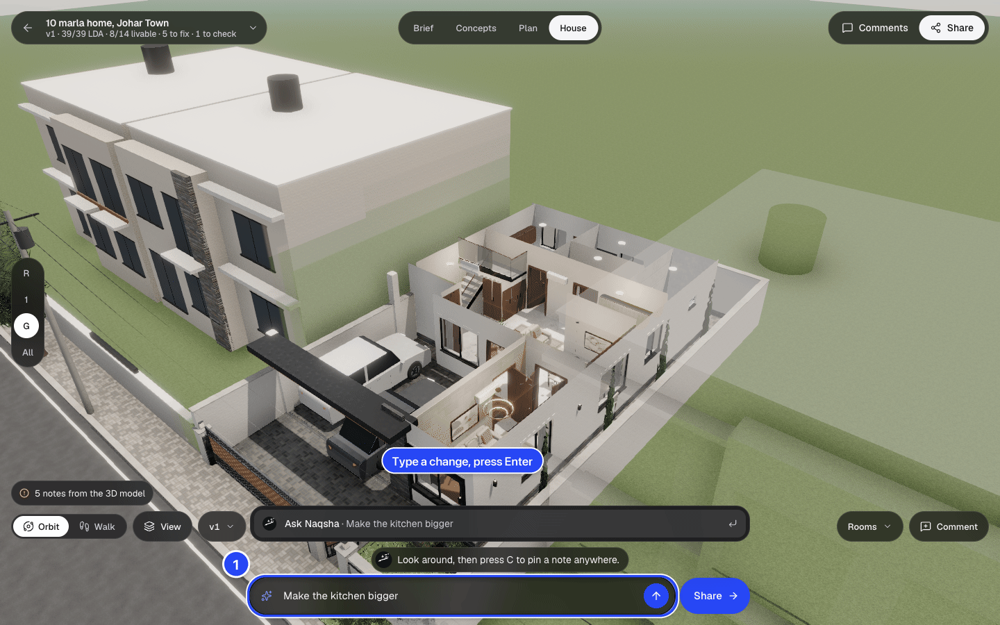

The conversation sheet narrates the work under **Your changes**: which rooms Naqsha is looking at, the rule checks, the furniture it redraws. Ours took **4 minutes 48 seconds**. Then click **See what changed**.

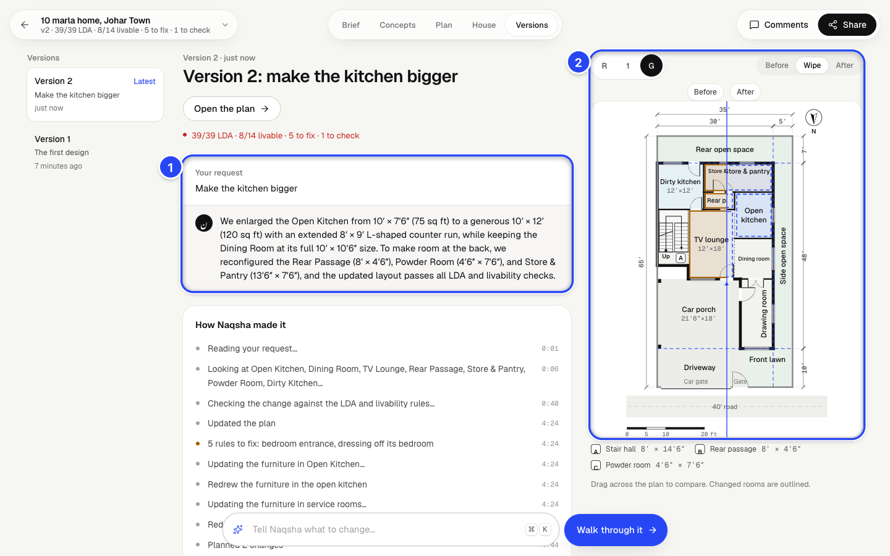

The **Versions** page shows your request and Naqsha's answer (1), **How Naqsha made it** with timings, **What changed** room by room in feet, and the plan before and after (2). Drag across the plan to compare.

---

## Path C: collaborate like a client

Use the home from Path B, or the sample from Path A.

### 1. Share a client link

Click **Share**, then switch on **Client link** (1). The link is copied for you ("Client link is on, and copied"). **Copy link** (2) copies it again.

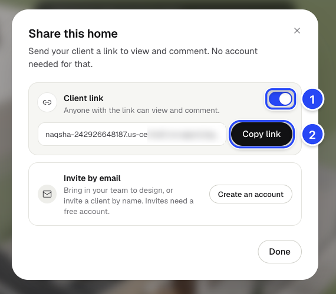

### 2. Comment as the client

Open the link in a private (incognito) window. That window is a different guest with no account. The header says **Shared with you · You can comment** (1).

Press **C** (or click **Comment**) and click a spot on the house. Enter **Your name** once (2), type the note and click **Post** (3). To see the agent push back on a bylaw, try:

```text
Extend the car porch 4 ft forward into the front lawn
```

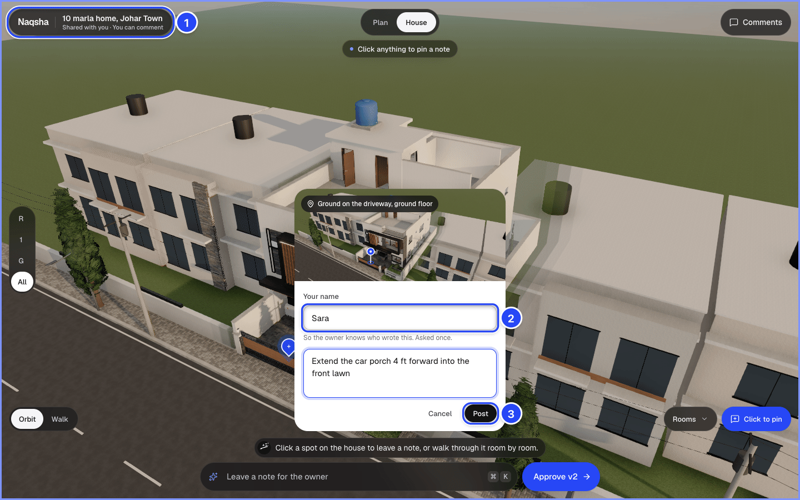

### 3. Back as the owner, revise with the comments

In your first window the client's note arrives without a reload, with the client's name and role (1). Add a note of your own if you like. We asked for a door into the master bedroom from the passage. Then click **Revise with 2 comments** (2).

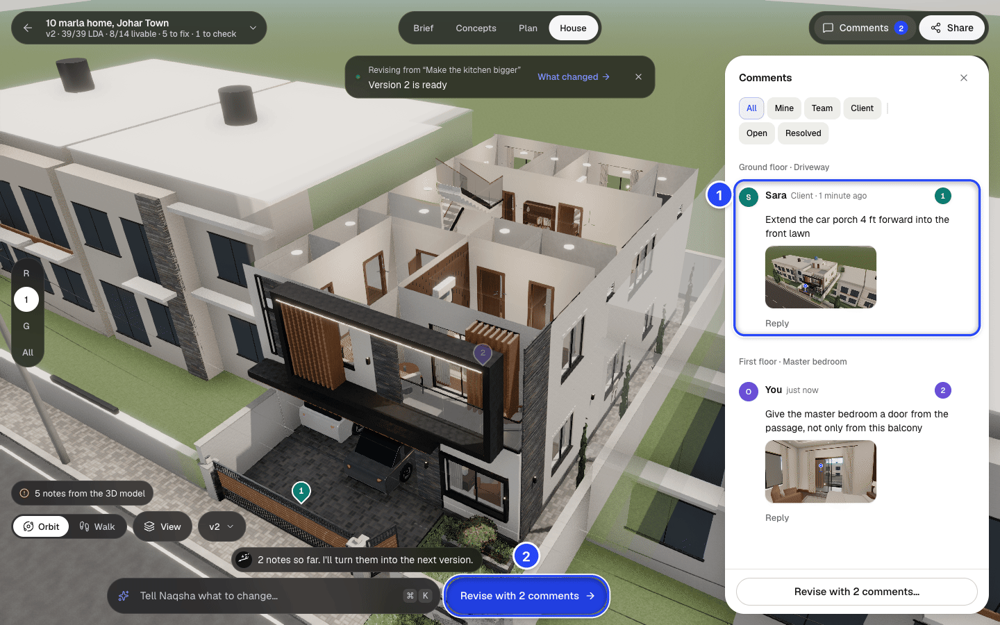

**Choose what to change** lists every open note with a tick box (1). Click **Revise with 2 comments** (2).

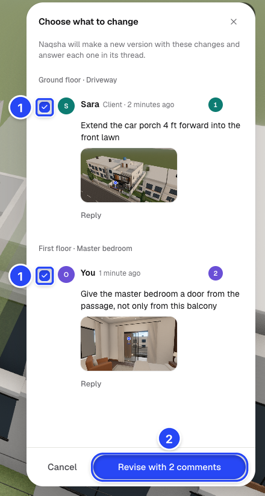

### 4. Read the answers

The Google ADK revision agent reads only the rooms it needs, tries each change against the LDA and livable rules, rewrites what passes, and answers every comment. A small change takes about 5 minutes. Our two-comment run moved walls and took **17 minutes**.

Open **See what changed** and scroll to **Your comments**:

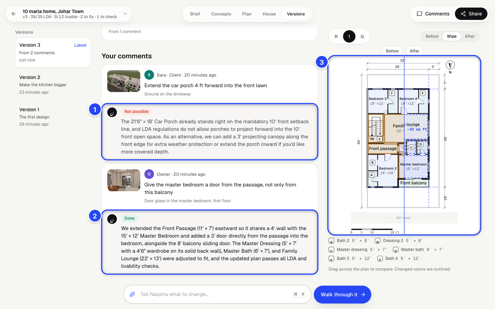

1. The porch: **Not possible**. The car porch already sits on the 10′ front setback line, and LDA does not allow it to project into the front open space. Naqsha suggests a canopy or extending the porch inward instead.
2. The door: **Done**, with the new sizes of every room it touched.
3. The plan before and after, with changed rooms outlined.

The client sees the same answers in their **Comments** thread. When you are done, switch the **Client link** off again in **Share**.

---

## Accounts (optional)

Anyone can make an account: **Sign in** → **Create an account**, then a name, an email and a password of at least 6 characters. There is no email verification. Please use a throwaway address.

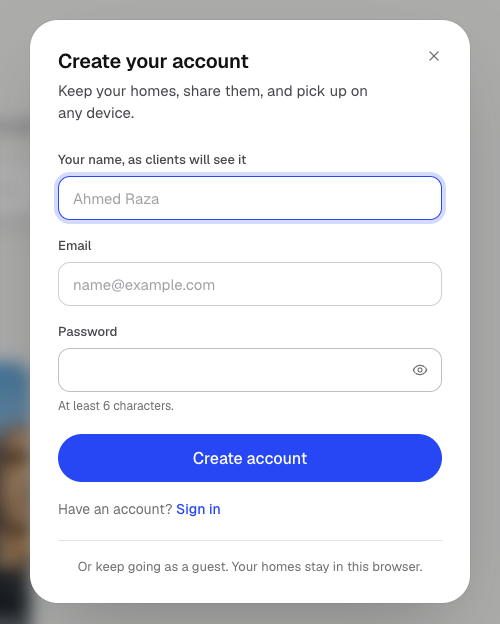

Without an account, your homes stay in this browser ("Guest · saved in this browser"). When you sign in, every home you made as a guest in that browser moves into the account, so you can open it on any device. Inviting a teammate by email needs an account; the client link does not.

---

## Controls cheat sheet

| Where | To | Do this |
|---|---|---|
| Orbit | Rotate | Drag |
| Orbit | Zoom | Scroll |
| Orbit | Pin a note | **C**, then click the house; **Esc** stops |
| Orbit or Walk | Switch between them | **V**, or **Orbit · Walk** |
| Walk | Look | Click once, then move the mouse (or drag) |
| Walk | Move | **W A S D** or the arrow keys; **Shift** to run |
| Walk | Go to a room | **M**, type, Enter (or click the minimap) |
| Walk | Change floor | **G**, **1**, **R**, or **[** and **]** |
| Walk | Pin a note | **C** (pins at the centre dot) |
| Walk | Stop | **Esc** frees the mouse; **Esc** again leaves Walk |
| Walk | See every control | **?** |
| Any view of a home | Jump to the Ask bar | **⌘K** (Ctrl+K on Windows) or **/** |

---

## What to look for

**The agents at work**
- **Setup agent (Google ADK, Gemini 3.8 Flash).** One message becomes a structured brief. It asks only what it still needs and lists the rules it guarantees.
- **Argon's fix loop and self-review (Gemini 4 Argon).** The run card counts the failing rules down round by round ("Fixing 20 → 8 → 5 → 7"). Then Argon reviews a drawing of its own plan before it writes the house as code.
- **Revision agent (Google ADK, Gemini 4 Argon).** **How Naqsha made it** shows the agent reading the rooms it needs, checking each change against the rules, and answering each comment with **Done** or **Not possible**. When a bylaw blocks a request, it names the rule and offers an alternative.

**The house**
- Furnished interiors in every room: use **Cut away** or walk in.
- Stairs that reach the roof, a roof door at the top landing, railings at every drop, the blue tank and the roof kept clear for solar.
- **Render this view** for a photoreal image of any angle you choose.

**The bylaw checks**
- The **Compliance** panel: coverage, floor area ratio, height, storeys, setbacks, room sizes, daylight, ventilation and stairs, plus the livable-home rules.
- The prototype checks against the Lahore Development Authority (LDA) Building and Zoning Regulations. Other Punjab authorities build on the same baseline, and the rules engine is built to take any authority's bylaws.
- The printed set includes a compliance report.

---

## Troubleshooting

- **Use desktop Chrome.** The 3D view needs WebGL with hardware acceleration. If the House view stays blank, turn on "Use graphics acceleration when available" in Chrome's settings and reload.
- **"Busy right now, retrying in N s…"** means the model asked us to back off for a moment. It retries by itself. There is nothing to click.
- **Runs survive a closed tab.** Design runs and revisions carry on on the server. Reopen the home from **Portal** → **Your homes**, and refresh the page if the progress card does not reappear.
- **Long waits are normal for the big steps:** about 5 to 7 minutes for a design run, and 5 to 20 minutes for a revision, depending on how much it changes.
- **Your guest homes live in one browser.** A private window, another browser or another device is a different guest. That is how the client in Path C works. Sign in if you want the same homes everywhere.
- **The client link only works while it is on.** Once it is switched off, the link shows "This link is no longer shared".

---

## More

- [README.md](README.md): what Naqsha is, the stack and how to run it.
- [docs/ARCHITECTURE.md](docs/ARCHITECTURE.md): the design rationale.
- Demo video (3:57): https://drive.google.com/file/d/1xmdn7qxZRsblvwNLezveUji1tdc8WjBB/view?usp=sharing
