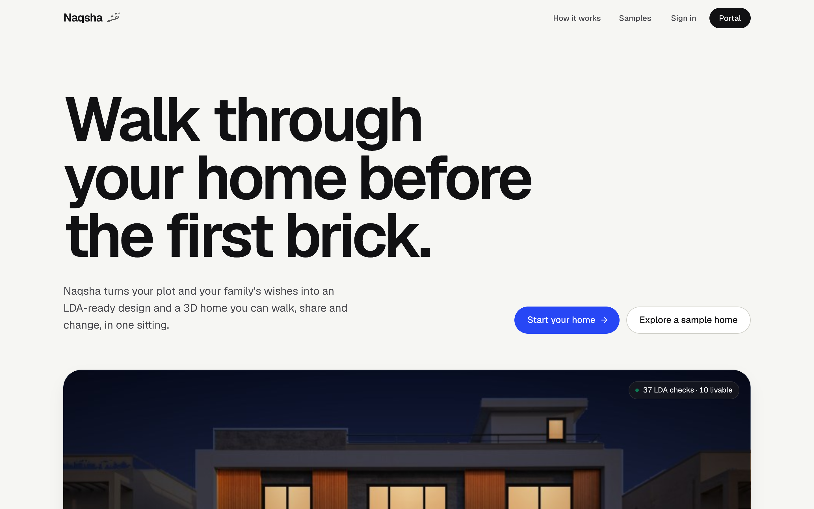
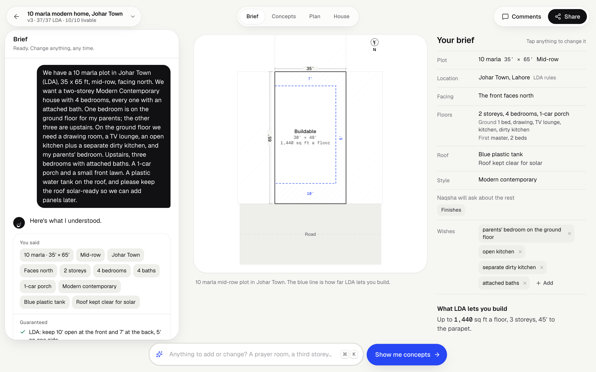
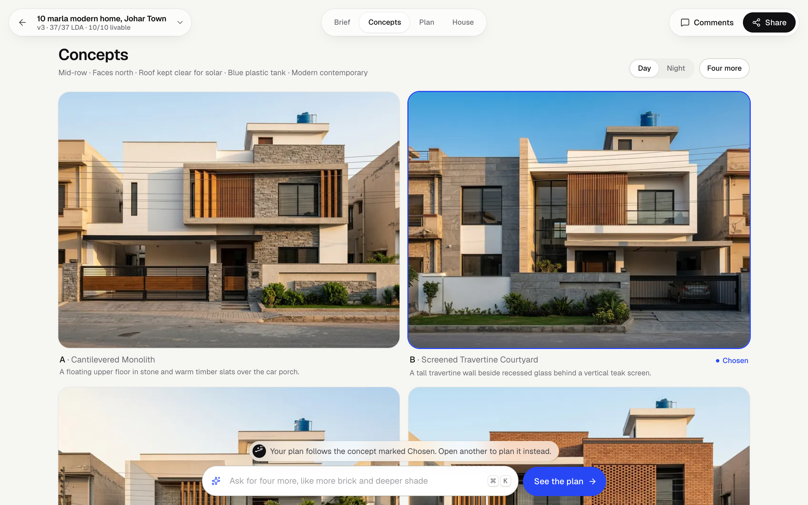
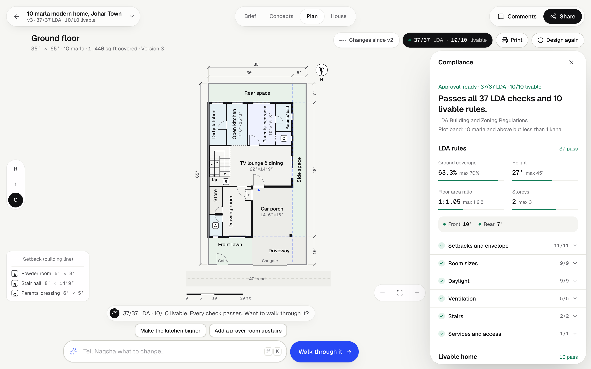
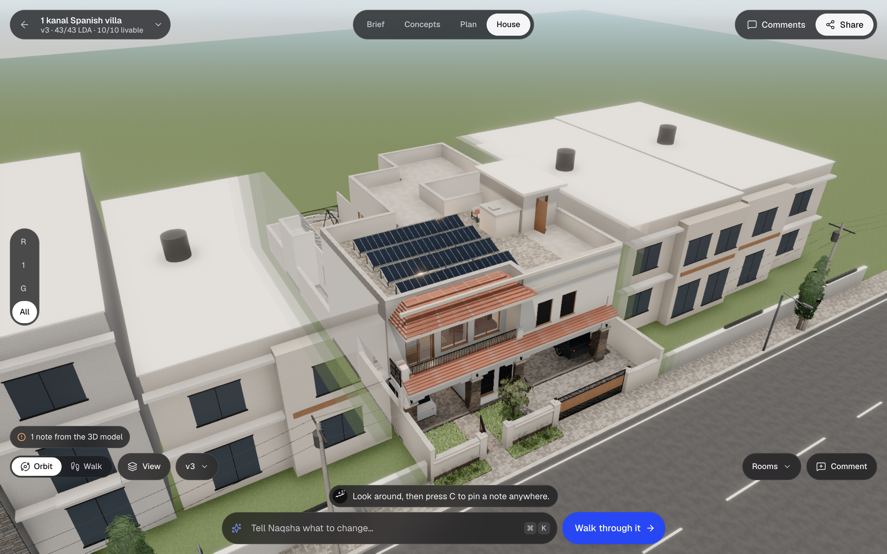
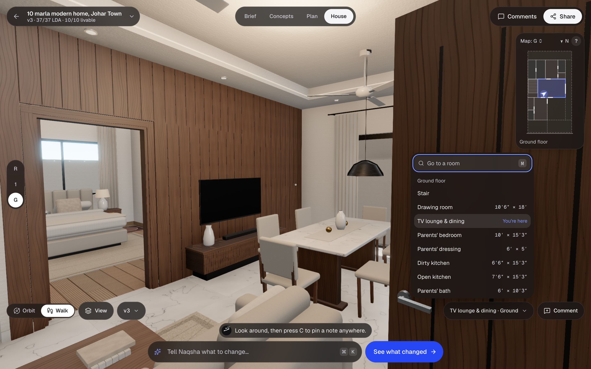
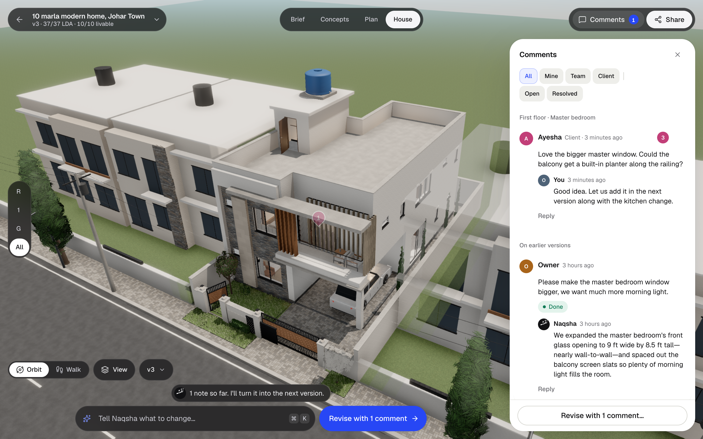
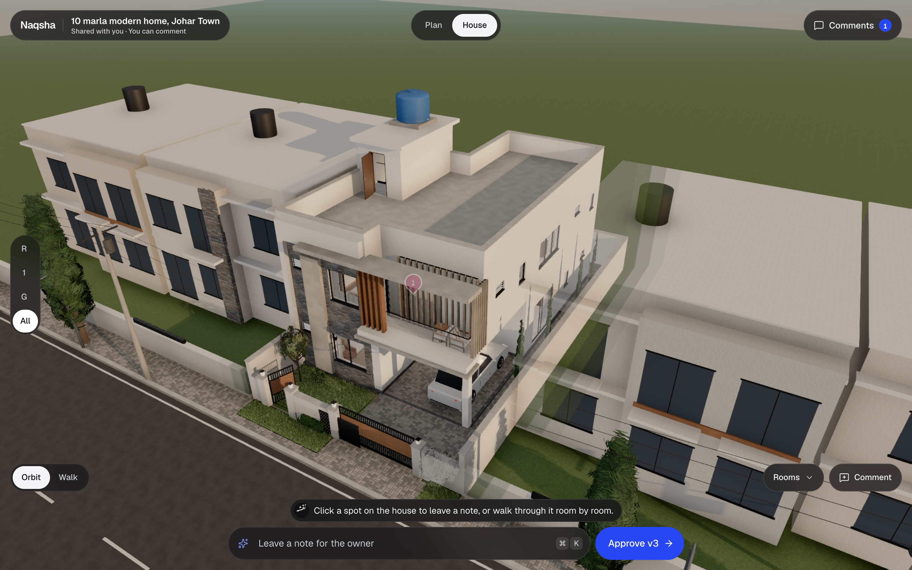
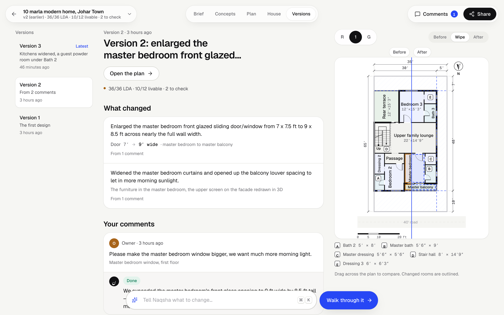
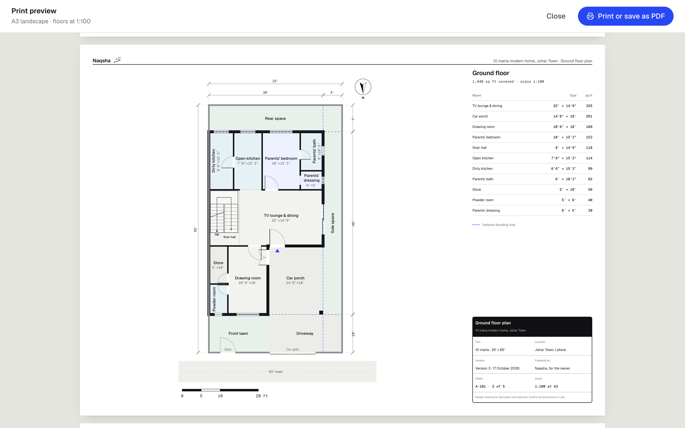

# Naqsha · نقشہ

**From a rough idea to a walkable, LDA-checked 3D home, designed by AI agents on Google Cloud.**

Live: https://naqsha-242926648187.us-central1.run.app (Cloud Run revision `naqsha-00009`). Open a sample home to walk one in a minute, no account needed.

Families in Lahore usually start building a house with a sketch on paper, a contractor's guess, and months of back-and-forth with an architect. Naqsha takes them from one message, *"10 marla in Johar Town, 4 bedrooms, modern"*, to:

- four photoreal concepts, by day and by night;
- a floor plan (*naqsha*) checked against the **Lahore Development Authority Building & Zoning Regulations 2019 (2026 consolidated text)** and against livable-home rules;
- a **3D model written as code by Gemini 4 Argon**, which they can **walk through like a game**;
- a home they can **share** with their architect, builder and family, whose comments an agent turns into a checked revision;
- drawings to print or save as PDF at 1:100.

## The journey

1. **Brief** (Google ADK agent, Gemini 3.8 Flash). Describe the plot in one message. The setup agent shows *Here's what I understood*, records a room program per floor, asks only what is missing (the water tank and solar included), and draws the LDA buildable envelope.
2. **Concepts** (Gemini 3.1 Flash Image). Four distinct exteriors from the same camera and light, each with a night version. If the model is rate-limited, images fall back to Nano Banana 2.1, then Gemini 3 Pro Image. Four take about 45–94 s.
3. **Plan** (Gemini 4 Argon). Argon produces a structured floor plan. Two deterministic engines check it: **18 LDA check types** (setbacks, coverage, FAR, height, storeys, room sizes, 8% daylight, ventilation, stairs, parapet, mumty, tank) and **10 livable-home rules** (independent rooms, every room reachable, stairs to the roof with the door at the landing, a railing at every drop, door keep-outs and clear walkways). Argon then **reviews a drawing of its own plan** like an architect, and an adaptive loop fixes what fails (on a big 1 kanal brief: 15 → 5 → 0 failures).
4. **House** (Gemini 4 Argon). Argon writes `design.js`: sections of code against our **House SDK**, which provides real wall openings, PBR materials, furniture, landscape and lighting. A 10 marla design takes about 5–6 min end to end.
5. **Walk.** Orbit with ghosted neighbours, day or night; walk in first person with mouse look, floor moves, a room navigator, collisions and stairs.
6. **Share, comment and revise** (Google ADK agent, Gemini 4 Argon). Owner, Team and Client roles; a client link (`/s/<token>`) that needs no account; threaded comments with authors. The owner picks which comments to apply, or types a change in the Ask bar. A tool-using ADK agent reads only the rooms and code it needs, dry-runs layout edits against the rules, rewrites sections, and answers every comment, in about 70 s. If a request breaks a regulation, it says which rule and proposes an alternative.
7. **Print.** A3 or A4 sheets: a cover with the concept and area schedule, every floor at 1:100, and a compliance report.

Accounts use **Firebase Authentication on Google Identity Platform** (email and password; Firebase ID tokens verified on the server). Guests can work without an account and claim their homes when they sign up.

## Screens

Captured from the live app on 17 Oct 2026 (revision `naqsha-00009`). More in [docs/screens/](docs/screens).

| | |
|---|---|
|  |  |
| **Landing.** Start a home, or explore a sample. | **Brief.** One message; Naqsha says what it understood and draws the LDA envelope. |
|  |  |
| **Concepts.** Four distinct exteriors, by day and night. | **Plan.** 37/37 LDA checks and 10/10 livable rules on the 10 marla sample. |
|  |  |
| **House.** The 1 kanal villa, written as code by Argon: tiled roofs and rooftop solar. | **Walk.** First person, with a room navigator and a minimap. |
|  |  |
| **Comments.** Authors and roles, threaded replies, and Naqsha's answers. | **Client view.** A shared link: comment and approve, no account needed. |
|  |  |
| **Revisions.** What changed, in feet, and which comments were done or refused. | **Print.** Every floor at 1:100 with a room schedule and title block. |

## Architecture

```
React SPA (Vite, three.js r186, react-three-fiber, three-mesh-bvh)
        │  REST + Server-Sent Events
Cloud Run · FastAPI (one service; also serves the SPA)
  ├─ Setup agent ............ Google ADK agent (gemini-3.8-flash), 5 tools
  ├─ Concepts / AI render ... gemini-3.1-flash-image ×4, day and night → Nano Banana 2.1 → 3 Pro Image
  ├─ Architect .............. gemini-4-argon: plan JSON ⟲ rules engine, self-review, then streamed design.js
  ├─ Reviser ................ Google ADK agent (gemini-4-argon), 9 tools
  ├─ Rules engine ........... deterministic Python: LDA rules from LDA's official PDFs + livable-home rules
  ├─ Firestore .............. projects, chat, versions, comments
  ├─ Cloud Storage .......... concepts, renders, comment snapshots
  └─ Identity Platform ...... accounts, roles, share links
Gemini via Vertex AI (Gemini Enterprise Agent Platform), `global` endpoint
```

Further reading:
- [docs/ARCHITECTURE.md](docs/ARCHITECTURE.md): the design rationale.
- [contracts/](contracts): the plan schema, the House SDK API that Argon writes against, and the HTTP/SSE API.
- [docs/research/lda-regulations.md](docs/research/lda-regulations.md): the sourced LDA rules.
- [docs/review/](docs/review): the testing rounds and their triage.

## How we tested it

Tester agents used the deployed app the way families, architects and builders would: 8 per round, over 3 rounds and a final verification. Every finding was triaged against the code ([docs/review/](docs/review)), fixed and redeployed, about 200 fixes in all. The final verification confirmed every must-fix item on the deployed code. The API has 123 tests:

```bash
cd api && uv run pytest
```

## Run locally

Prerequisites: Node 22, Python 3.13, `uv`, and gcloud signed in with access to the project.

```bash
gcloud auth application-default login
cd api && uv sync && uv run uvicorn app.main:app --port 8080
cd web && npm ci && npm run dev
```

The API runs on :8080 and the web app on :5173. To work on the UI without the backend, use mock mode:

```bash
cd web && VITE_MOCK=1 npm run dev
```

## Deploy

```bash
gcloud run deploy naqsha --source . --region us-central1 \
  --service-account agent-runtime@PROJECT.iam.gserviceaccount.com --allow-unauthenticated --timeout 3600 \
  --set-env-vars GOOGLE_GENAI_USE_ENTERPRISE=TRUE,GOOGLE_CLOUD_PROJECT=PROJECT,GOOGLE_CLOUD_LOCATION=global
```

## Disclaimer

Naqsha produces concept designs and a regulation pre-check. LDA requires building plans to be stamped by a PCATP-registered architect before submission.
