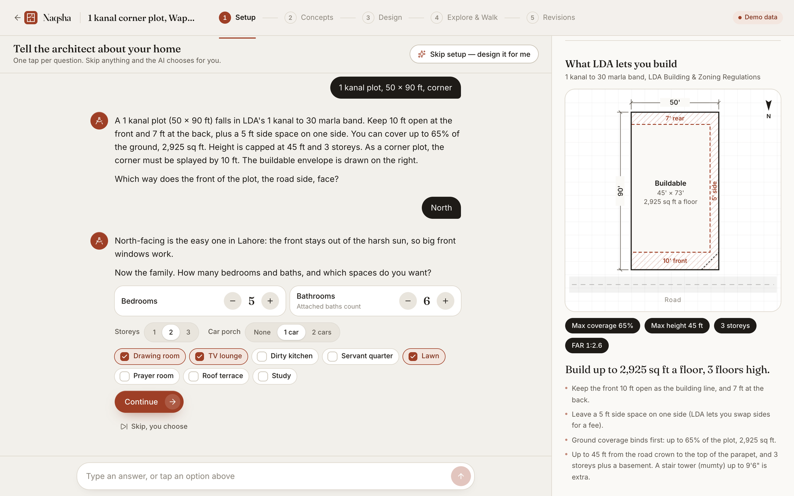
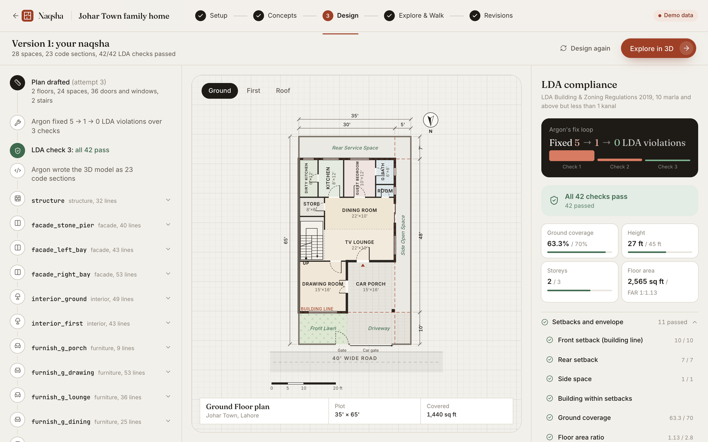
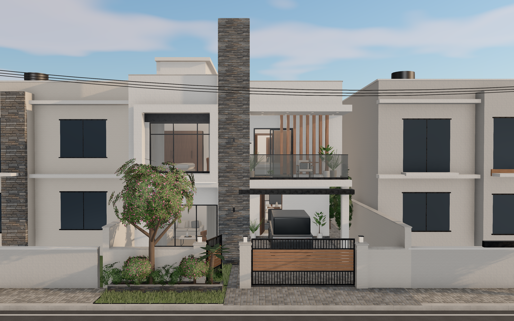
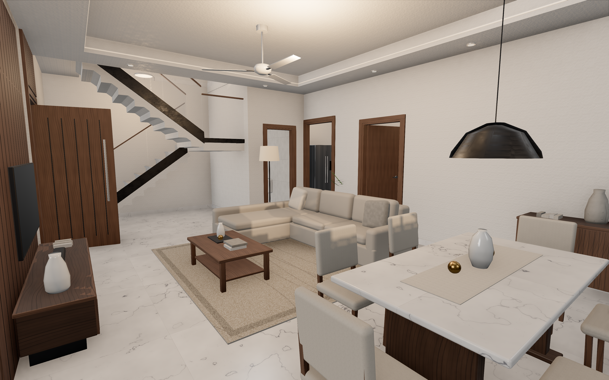
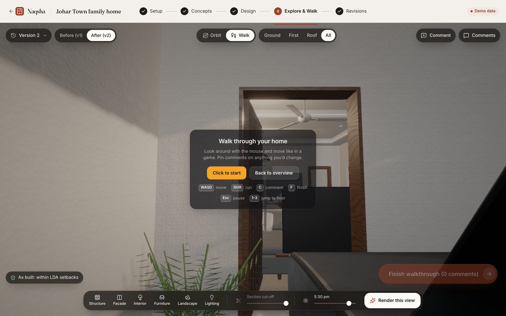
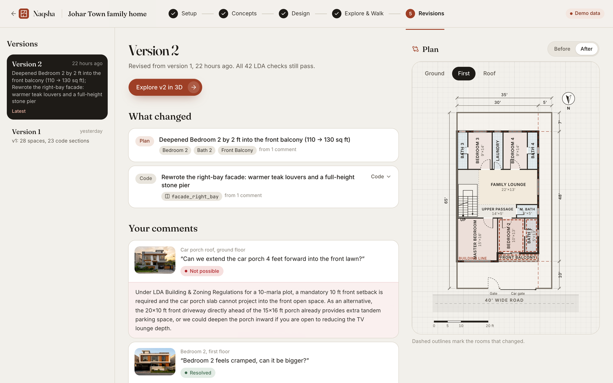

# Naqsha · نقشہ

**From a rough idea to a walkable, LDA-compliant 3D home, designed by AI agents on Google Cloud.**

Families in Lahore usually start building a house with a sketch on paper, a contractor's guess, and months of back-and-forth with an architect. Naqsha takes them from *"10 marla in Johar Town, 4 bedrooms, modern"* to:

- photoreal concept images;
- a floor plan (*naqsha*) checked against the **Lahore Development Authority Building & Zoning Regulations 2019 (2026 consolidated text)**;
- a **high-fidelity 3D model written as code by Gemini 4 Argon**, which they can **walk through like a game**;
- comments dropped anywhere in the model, which the agent turns into a compliant revision.

## The journey

1. **Setup agent** (Gemini 3.8 Flash). A one-tap chat covers plot, floors, rooms and style. Each answer is a single click on a chip, and "Skip, design it for me" fills the rest. The LDA *buildable envelope* (setbacks, coverage, height, storeys) appears as soon as the plot size is known.
2. **Concepts** (Gemini 3.1 Flash Image). Four photoreal exteriors are generated in parallel in about 17 s, and any of them can be remixed with a text instruction.
3. **Plan** (Gemini 4 Argon). Argon produces a structured floor plan. A deterministic **LDA compliance engine** checks setbacks, coverage, FAR, height, storeys, room minimums, 8% daylight, ventilation, stairs, parapet and mumty. Argon fixes violations in a loop.
4. **Build** (Gemini 4 Argon). Argon writes `design.js`: sections of code against our **House SDK**, which provides real wall openings, PBR materials, furniture, landscape and lighting. The model streams into the browser and assembles layer by layer: structure → facade → interiors → furniture → landscape.
5. **Explore and walk.** The viewer offers orbit, floor and layer toggles, a section cut and a sun slider, plus first-person walking with collisions and stairs. *Render this view* turns a viewport into a photoreal image.
6. **Comment and revise** (Google ADK agent). The family pins comments on any surface. When they finish the walkthrough, a tool-using ADK agent reads only the rooms and code it needs, dry-runs layout edits against the LDA engine, rewrites sections, and explains every resolution. If a request would break a regulation, the agent says which rule and proposes a compliant alternative.

## Screens

| | |
|---|---|
|  |  |
| **Setup.** One-tap chat; the LDA envelope appears as soon as the plot size is known. | **Plan.** Argon's dimensioned *naqsha* and the LDA fix loop: 5 → 1 → 0 violations. |
|  |  |
| **Build.** The 3D model written by Gemini 4 Argon as House SDK code, matching the chosen concept. | **Interiors.** Marble, joinery, false ceilings, ceiling fans. Every piece comes from code. |
|  |  |
| **Walk.** First-person walkthrough with collisions, stairs, a minimap and pinned comments. | **Revise.** The ADK agent resolves comments and refuses ones that break LDA rules, explaining why. |

## Architecture

```
React SPA (Vite, three.js r186, react-three-fiber, three-mesh-bvh)
        │  REST + Server-Sent Events
Cloud Run · FastAPI (one service; also serves the SPA)
  ├─ Setup agent ............ gemini-3.8-flash (structured turns)
  ├─ Concepts / AI render ... gemini-3.1-flash-image (4× parallel)
  ├─ Architect .............. gemini-4-argon: plan JSON ⟲ LDA engine, then streamed design.js
  ├─ Reviser ................ Google ADK Agent (gemini-4-argon) with 9 tools
  ├─ LDA compliance engine .. deterministic Python, rules extracted from LDA's official PDFs
  ├─ Firestore .............. projects, chat, versions, comments
  └─ Cloud Storage .......... concepts, renders, comment snapshots
Gemini via Vertex AI (Gemini Enterprise Agent Platform), `global` endpoint
```

Further reading:
- [docs/ARCHITECTURE.md](docs/ARCHITECTURE.md): the design rationale.
- [contracts/](contracts): the plan schema, the House SDK API that Argon writes against, and the HTTP/SSE API.
- [docs/research/lda-regulations.md](docs/research/lda-regulations.md): the sourced LDA rules.

## Run locally

Prerequisites: Node 22, Python 3.13, `uv`, and gcloud signed in with access to the project.

```bash
gcloud auth application-default login
cd api && uv sync && uv run uvicorn app.main:app --port 8080
cd web && npm ci && npm run dev
```

The API runs on :8080 and the web app on :5173. To work on the UI without the backend, use mock mode:

```bash
cd web && VITE_MOCK=1 npm run dev
```

## Deploy

```bash
gcloud run deploy naqsha --source . --region us-central1 \
  --service-account agent-runtime@PROJECT.iam.gserviceaccount.com --allow-unauthenticated --timeout 3600 \
  --set-env-vars GOOGLE_GENAI_USE_ENTERPRISE=TRUE,GOOGLE_CLOUD_PROJECT=PROJECT,GOOGLE_CLOUD_LOCATION=global
```

## Disclaimer

Naqsha produces concept designs and a regulation pre-check. LDA requires building plans to be stamped by a PCATP-registered architect before submission.
